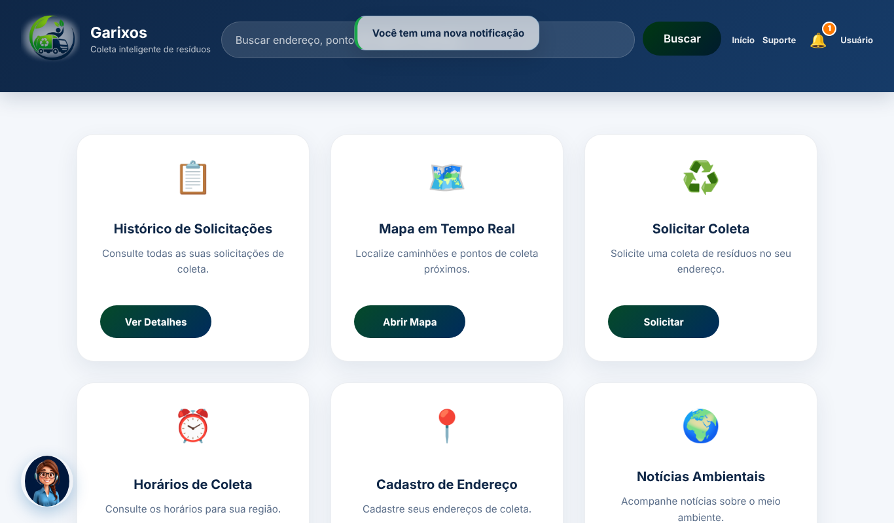
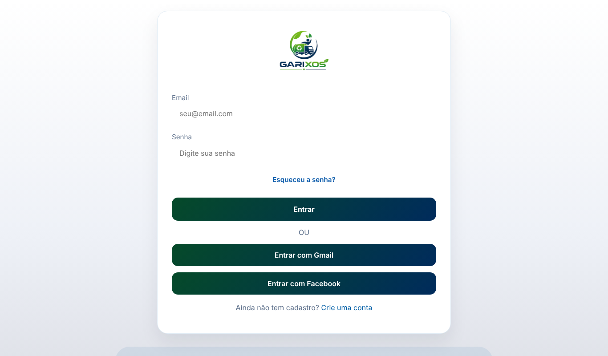
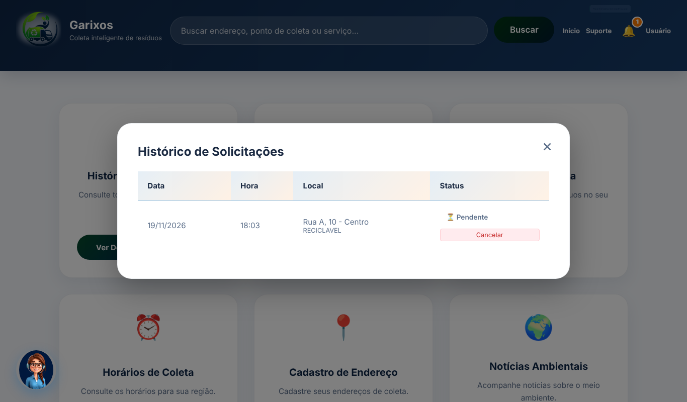
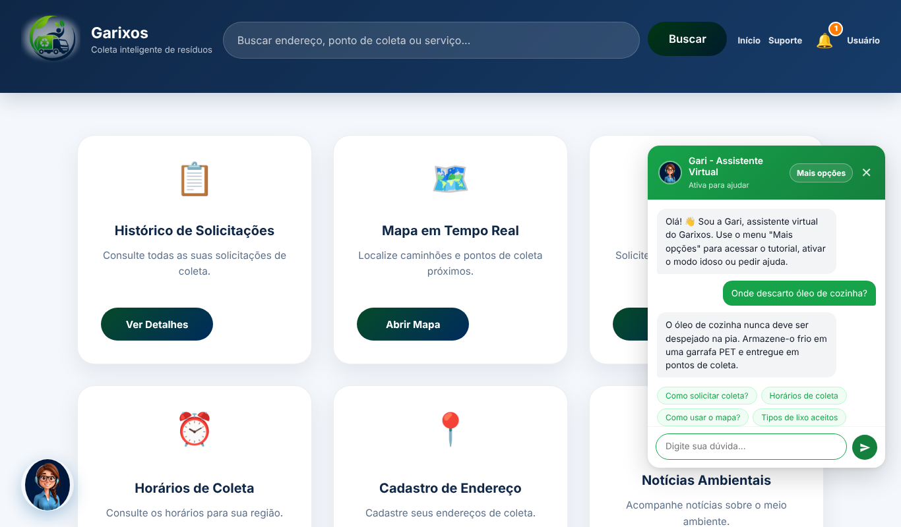
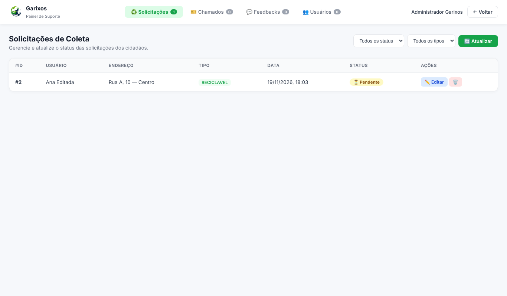
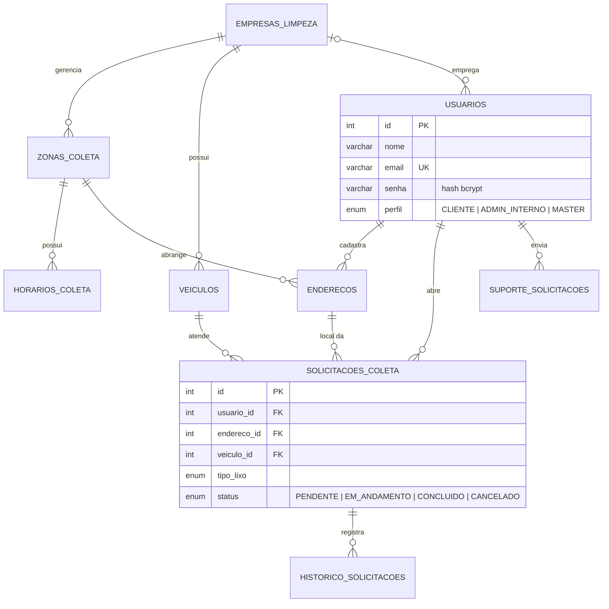

# ♻️ Garixos — Gestão de Zeladoria e Coleta de Resíduos


Plataforma **fullstack** que conecta cidadãos às empresas de limpeza urbana. O cidadão cadastra endereços,
solicita coletas (orgânico, reciclável, eletrônico, poda, entulho), acompanha o status e tira dúvidas com uma
assistente virtual. As empresas gerenciam solicitações, chamados e usuários num painel administrativo.

> Projeto acadêmico desenvolvido em equipe com Scrum. Depois da entrega, o projeto passou por uma revisão
> de segurança e organização do código (detalhes em [Melhorias pós-entrega](#-melhorias-pós-entrega)).

<p align="center">
  
</p>

| Login | Histórico de solicitações |
|---|---|
|  |  |
| **Assistente virtual "Gari"** | **Painel administrativo** |
|  |  |

---

## ✨ Funcionalidades

**Portal do cidadão**
- Cadastro com validação de senha forte e preenchimento de endereço pelo CEP (ViaCEP)
- Solicitação de coleta por tipo de resíduo e acompanhamento do status no histórico
- Cadastro de vários endereços, mapa de caminhões/pontos de coleta (Leaflet) e tabela de horários
- Assistente virtual **Gari**, integrada ao **Google Gemini** (com respostas prontas quando não há chave)
- Tutorial guiado e **modo idoso** (fonte ampliada e leitura em voz alta)
- Abertura de chamados de suporte e envio de feedback

**Painel administrativo** (`/suporte.html`, perfis `MASTER` / `ADMIN_INTERNO`)
- Gestão das solicitações de coleta (status, alocação de veículo)
- Gestão de chamados, feedbacks e usuários

**API REST**
- CRUD de usuários, endereços, solicitações, empresas, zonas de coleta, veículos e suporte
- Autenticação **JWT**, senhas com **bcrypt** e controle de acesso por perfil

---

## 🛠️ Stack

| Camada | Tecnologias |
|---|---|
| Front-end | HTML5, CSS3, JavaScript (vanilla), Leaflet |
| Back-end | Node.js, Express 5, Sequelize ORM |
| Banco de dados | PostgreSQL (migrations + seeders) |
| Segurança | JWT, bcrypt, Helmet, rate limiting |
| IA | Google Gemini API |
| Qualidade | Testes com `node:test`, CI com GitHub Actions |

---

## 🗂️ Estrutura

```
├── app.js               # Configuração do Express (middlewares, rotas, erros)
├── server.js            # Inicialização: conecta no banco e sobe o servidor
├── config/config.js     # Conexão com o banco via variáveis de ambiente
├── middlewares/auth.js  # JWT + regras de permissão por perfil
├── routes/              # Rotas da API separadas por entidade
├── services/            # Assistente virtual (Gemini + respostas prontas)
├── repositories/        # Acesso a dados (Sequelize)
├── models/              # Entidades e associações
├── migrations/          # Criação/alteração das tabelas
├── seeders/             # Dados iniciais (empresas, zonas, admin)
├── public/              # Front-end (HTML, CSS, JS, imagens)
└── test/                # Testes automatizados
```

### Diagrama Entidade-Relacionamento



---

## 🚀 Como rodar

**Pré-requisitos:** Node.js 20+ e PostgreSQL.

```bash
git clone https://github.com/Toliveira-08/Garixos-RJ.git
cd Garixos-RJ
npm install

cp .env.example .env      # ajuste usuário/senha do banco, JWT_SECRET e ADMIN_*
npm run db:setup          # cria o banco, roda as migrations e os seeders
npm run dev               # http://localhost:3000
```

- O seed cria o administrador definido em `ADMIN_EMAIL` / `ADMIN_PASSWORD`.
- Para a assistente usar IA de verdade, preencha `GEMINI_API_KEY` no `.env`. Sem a chave, ela funciona
  com respostas prontas.
- `npm test` roda os testes automatizados.

### Principais rotas da API

| Método | Rota | Acesso |
|---|---|---|
| `POST` | `/api/usuarios` | Público (cadastro de cidadão) |
| `POST` | `/api/login` | Público, retorna o token JWT |
| `GET` | `/api/solicitacoes` | Cidadão vê as suas, admin vê todas |
| `POST` | `/api/solicitacoes` | Cidadão logado |
| `PUT` | `/api/solicitacoes/:id` | Admin |
| `GET/POST/PUT/DELETE` | `/api/enderecos` | Dono do endereço ou admin |
| `GET/POST` | `/api/suporte` | Cidadão logado (só os próprios) / admin |
| `GET` | `/api/usuarios` | Admin |
| `GET/POST/PUT/DELETE` | `/api/empresas`, `/api/zonas`, `/api/veiculos` | Leitura: logado · Escrita: admin |
| `POST` | `/api/assistant/chat` | Cidadão logado |

---

## 🔒 Melhorias pós-entrega

Revisão feita depois da entrega acadêmica para deixar o projeto mais próximo de produção:

- **Senhas com hash bcrypt.** Antes eram salvas em texto puro e comparadas direto no banco.
- **Autenticação JWT e permissões por perfil.** Antes as rotas eram abertas: qualquer pessoa podia listar
  ou excluir usuários. Agora o cidadão só acessa os próprios dados e o cadastro público não consegue criar admin.
- **Admin criado por seed com credenciais do `.env`**, no lugar de um login "master" fixo no código.
- **Segredos fora do código e do histórico.** Configuração do banco via variáveis de ambiente e chave do
  Gemini enviada só pelo servidor (em header, não na URL).
- **Organização.** O `server.js` de quase 800 linhas virou rotas por entidade, middleware de auth, service
  da assistente e tratamento central de erros. O front-end foi para `public/` e é servido pelo Express.
- **Integridade do banco.** Email único e obrigatório, e corrigido o ENUM de `dia_semana`, que tinha os
  valores de perfil por engano.
- **Higiene do repositório.** `node_modules` removida do versionamento, scripts temporários removidos,
  imagens otimizadas (de ~5,5 MB para ~450 KB) e scripts npm para setup.
- **Qualidade.** Testes automatizados, CI no GitHub Actions, Helmet e rate limit no login e na assistente.

---

## 👥 Equipe

| Papel | Integrantes |
|---|---|
| Product Owner | Thiago Oliveira |
| Scrum Master | Accioli |
| Front-end | Natã e Stefany |
| Back-end | João e Diego |
| Banco de Dados | Caue e Edu |

